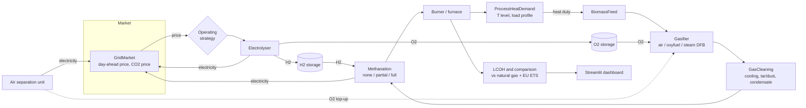

# Biomass Process Heat

**Agent-based simulation and economic assessment of biomass-based process chains for
industrial high-temperature process heat.** This independent open-source project looks at
how biogenic syngas from thermochemical biomass gasification can replace natural gas in
industrial furnaces and burners. It covers air gasification, oxyfuel gasification with
partial or full methanation, oxygen and hydrogen supply via electrolysis and H2/O2 storage,
and electricity-price-dependent operation. Each chain is compared with natural gas plus the
EU ETS CO2 price on a **levelised cost of heat (LCOH)** basis.

The project is a **series of public repositories**, built step by step. This umbrella repo
holds the overview, architecture, roadmap, methods notes, scenario definitions and the
final write-up.

## Why

Most industrial heat above ~500 degC still comes from burning natural gas. Electrification
is hard at very high temperatures and in existing furnaces. Gasified biomass is a renewable
gas fuel that can, with the right conditioning, come close to natural gas. The open question
is which process chain gives the cheapest heat for a given process. Air-blown gas is cheap
but N2-diluted. Oxyfuel needs O2. Methanation needs H2. Electrolysis produces both and can
follow electricity prices.

## Architecture



The plant model is **agent-based**: every unit is an agent with its own parameters, state
and ledger. A scheduler passes messages between them each time step: heat demand, gas
streams, H2/O2 flows and electricity. Operating strategies are pluggable agents too.

## Roadmap

| # | Repository | Content | Status |
|---|---|---|---|
| 1 | [biomass-process-heat](https://github.com/DataWithSyed/biomass-process-heat) (this repo) | overview, architecture, roadmap, [methods notes](docs/methods.md), [scenarios](docs/scenarios.md), final report | in progress |
| 2 | [biomass-heat-plant-model](https://github.com/DataWithSyed/biomass-heat-plant-model) | modular agent-based plant model, mass and energy balances, gas quality, O2/H2 demand | v0.1 done |
| 3 | `biomass-heat-electrolysis-dispatch` | price-dependent electrolysis and H2/O2 storage strategies on real German day-ahead prices | planned |
| 4 | `biomass-heat-lcoh` | LCOH, natural gas + EU ETS comparison, sensitivity, Monte Carlo, tornado charts | planned |
| 5 | `biomass-heat-scenarios` | industrial process requirement scenarios and configuration screening | planned |
| 6 | `biomass-heat-dashboard` | interactive Streamlit UI to select and compare process chains | planned |
| 7 | this repo, `report/` | final write-up of results | planned |

- [x] **1. Umbrella repo**: README, architecture, roadmap, methods/literature notes, scenario definitions (2026-11-05)
- [x] **2. Plant model** [`biomass-heat-plant-model`](https://github.com/DataWithSyed/biomass-heat-plant-model): agents, gasifier (air/oxyfuel/steam), cleaning, methanation (none/partial/full), electrolyser, H2/O2 storage, ASU, burner, market; design-point and hourly simulation; 33 tests (2026-11-05)
- [ ] **3. Electrolysis dispatch** `biomass-heat-electrolysis-dispatch`: real DE-LU day-ahead prices (Energy-Charts / SMARD), follow-demand vs price-threshold vs optimised (LP) electrolyser + storage operation, electrolyser/storage sizing
- [ ] **4. LCOH** `biomass-heat-lcoh`: CAPEX/OPEX models, annuity-based LCOH, natural gas + EU ETS CO2 cost, break-even CO2 price, sensitivity, Monte Carlo, tornado charts
- [ ] **5. Scenarios and screening** `biomass-heat-scenarios`: process requirement scenarios (temperature, load profile, gas quality limits), feasibility filter and ranking of chains
- [ ] **6. Dashboard** `biomass-heat-dashboard`: Streamlit app for picking and comparing chains
- [ ] **7. Final report** in this repo (`report/`)
- [ ] Plant-model enhancements: recuperative air preheat, DFB flue-gas heat recovery, tar/C2+ species, part-load behaviour

## First results (from the plant model, 10 MW of heat at 1000 degC)

| Chain | Fuel LHV (MJ/Nm3) | Wobbe (MJ/Nm3) | Biomass MWh/MWh_heat | Electricity MWh/MWh_heat | H2 kg/MWh_heat |
|---|---|---|---|---|---|
| Air gasification | 5.5 | 6.4 | 3.49 | 0.02 | 0 |
| Oxyfuel, no methanation | 9.7 | 12.5 | 2.54 | 0.05 | 0 |
| Oxyfuel + partial methanation | 24.1 | 29.0 | 1.66 | 1.90 | 33 |
| Oxyfuel + full methanation | 33.5 | 50.6 | 1.08 | 2.42 | 43 |
| Natural gas (reference) | 36.8 | 52.7 | 1.91 (NG) | - | - |

With full methanation the fuel comes close to natural gas. The electrolyser then produces
4.4 times the O2 the gasifier needs. See the
[plant-model README](https://github.com/DataWithSyed/biomass-heat-plant-model) for the
assumptions and limitations.

## Repository layout

```
docs/methods.md      literature and methods overview (verifiable references only)
docs/scenarios.md    technical and economic scenario definitions
report/              final write-up (step 7)
```

## Licence

MIT, see [LICENSE](LICENSE). Text and figures may be reused with attribution.
