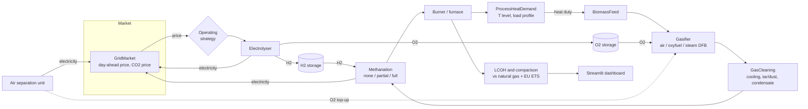
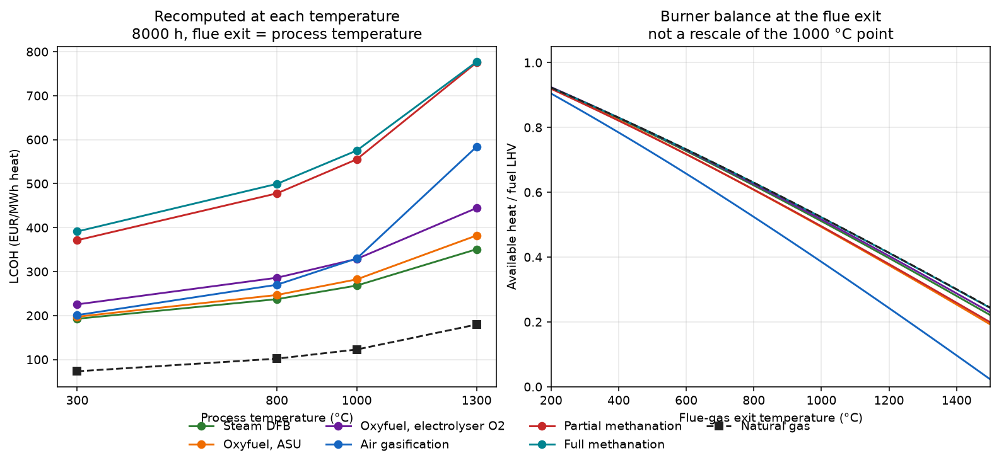

# Biomass Process Heat

**Agent-based simulation and economic assessment of biomass-based process chains for
industrial high-temperature process heat.** This independent open-source project looks at
how biogenic syngas from thermochemical biomass gasification can replace natural gas in
industrial furnaces and burners. It covers air gasification, oxyfuel gasification with
partial or full methanation, oxygen and hydrogen supply via electrolysis and H2/O2 storage,
and electricity-price-dependent operation. Each chain is compared with natural gas plus the
EU ETS CO2 price on a **levelised cost of heat (LCOH)** basis.

The project is a **series of public repositories**, built step by step. This umbrella repo
holds the overview, architecture, roadmap, methods notes, scenario definitions and the
final write-up.

## Why

Most industrial heat above ~500 degC still comes from burning natural gas. Electrification
is hard at very high temperatures and in existing furnaces. Gasified biomass is a renewable
gas fuel that can, with the right conditioning, come close to natural gas. The open question
is which process chain gives the cheapest heat for a given process. Air-blown gas is cheap
but N2-diluted. Oxyfuel needs O2. Methanation needs H2. Electrolysis produces both and can
follow electricity prices.

## Architecture



The plant model is **agent-based**: every unit is an agent with its own parameters, state
and ledger. A scheduler passes messages between them each time step: heat demand, gas
streams, H2/O2 flows and electricity. Operating strategies are pluggable agents too.

## Roadmap

| # | Repository | Content | Status |
|---|---|---|---|
| 1 | [biomass-process-heat](https://github.com/DataWithSyed/biomass-process-heat) (this repo) | overview, architecture, roadmap, [methods notes](docs/methods.md), [scenarios](docs/scenarios.md), final report | in progress |
| 2 | [biomass-heat-plant-model](https://github.com/DataWithSyed/biomass-heat-plant-model) | modular agent-based plant model, mass and energy balances, gas quality, O2/H2 demand | v0.1 done |
| 3 | [biomass-heat-electrolysis-dispatch](https://github.com/DataWithSyed/biomass-heat-electrolysis-dispatch) | price-dependent electrolysis and H2/O2 storage strategies on real German day-ahead prices | v0.1 done |
| 4 | [biomass-heat-lcoh](https://github.com/DataWithSyed/biomass-heat-lcoh) | LCOH, natural gas + EU ETS comparison, break-even CO2, sensitivity, Monte Carlo, tornado charts | v0.1 done |
| 5 | `scenarios/` in this repo (package `biomass-heat-scenarios`; no separate repository) | industrial process temperatures, load, fuel-gas screen, LCOH rank vs natural gas | v0.1 done |
| 6 | `biomass-heat-dashboard` | interactive Streamlit UI to select and compare process chains | planned |
| 7 | this repo, `report/` | final write-up of results | planned |

- [x] **1. Umbrella repo**: README, architecture, roadmap, methods/literature notes, scenario definitions (2026-11-05)
- [x] **2. Plant model** [`biomass-heat-plant-model`](https://github.com/DataWithSyed/biomass-heat-plant-model): agents, gasifier (air/oxyfuel/steam), cleaning, methanation (none/partial/full), electrolyser, H2/O2 storage, ASU, burner, market; design-point and hourly simulation; 33 tests (2026-11-05)
- [x] **3. Electrolysis dispatch** [`biomass-heat-electrolysis-dispatch`](https://github.com/DataWithSyed/biomass-heat-electrolysis-dispatch): real DE-LU day-ahead prices (Energy-Charts / SMARD, CC BY 4.0), O1 follow-demand / O2 price-threshold / O3 perfect-foresight LP / O4 rolling day-ahead; at 1.5× electrolyser + 24 h storage O3 cuts electricity cost ~23 % vs O1 (oxy_full 268 → 206 EUR/MWh_heat; O4 recovers 93–98 %); oversizing is the main lever (1× barely helps); 9 tests (2026-11-06)
- [x] **4. LCOH** [`biomass-heat-lcoh`](https://github.com/DataWithSyed/biomass-heat-lcoh): CAPEX/O&M scaled from GoBiGas cost data (Thunman 2019), electrolyser (Schmidt 2017), storage/methanation (Götz 2016), EUR 2025 via HICP; annuity LCOH vs natural gas (Eurostat DE I4) + EUA (DEHSt); break-even CO2/gas price, LCOH-optimal electrolyser sizing, tornado, 10k Monte Carlo, scale sweep; at 10 MW the cheapest chain (DFB) is 268 vs 123 EUR/MWh for gas, break-even CO2 ≈ 450 EUR/t; 19 tests (2026-11-07)
- [x] **5. Scenarios and screening**, in this repo under [`scenarios/`](scenarios/) (roadmap name `biomass-heat-scenarios`; there is no separate repository): 300/800/1000/1300 °C with flue exit kept distinct from process temperature, 8000 h and a 4160 h two-shift load, EASEE-gas Wobbe/density screen, LCOH recomputed from the plant model rather than rescaled from 1000 °C; 27 tests (2026-11-07)
- [ ] **6. Dashboard** `biomass-heat-dashboard`: Streamlit app for picking and comparing chains. Not started. No repository yet.
- [ ] **7. Final report** in this repo (`report/`)
- [ ] Plant-model enhancements: recuperative air preheat, DFB flue-gas heat recovery, tar/C2+ species, part-load behaviour

## First results (from the plant model, 10 MW of heat at 1000 degC)

| Chain | Fuel LHV (MJ/Nm3) | Wobbe (MJ/Nm3) | Biomass MWh/MWh_heat | Electricity MWh/MWh_heat | H2 kg/MWh_heat |
|---|---|---|---|---|---|
| Air gasification | 5.5 | 6.4 | 3.49 | 0.02 | 0 |
| Oxyfuel, no methanation | 9.7 | 12.5 | 2.54 | 0.05 | 0 |
| Oxyfuel + partial methanation | 24.1 | 29.0 | 1.66 | 1.90 | 33 |
| Oxyfuel + full methanation | 33.5 | 50.6 | 1.08 | 2.42 | 43 |
| Natural gas (reference) | 36.8 | 52.7 | 1.91 (NG) | - | - |

With full methanation the fuel comes close to natural gas. The electrolyser then produces
4.4 times the O2 the gasifier needs. See the
[plant-model README](https://github.com/DataWithSyed/biomass-heat-plant-model) for the
assumptions and limitations.

## Dispatch results (electrolysis repo, DE-LU day-ahead 2025-10-30 → 2026-10-30)

At **1.5 × electrolyser + 24 h H2/O2 storage**, perfect-foresight LP (O3) cuts electricity
cost by about **23 %** vs follow-demand across the three electrolyser configs; rolling
day-ahead (O4) recovers 93–98 % of that. At 1.0 × capacity the saving is &lt; 1 % — storage
alone is not enough; oversizing is the lever (oxy_full O3: 266 → 179 EUR/MWh_heat from
1× to 2×). Mean DA price 110.8 EUR/MWh; O3 volume-weighted purchase ~85 EUR/MWh_el.

| Config | O1 | O3 | O4 | O3 VWAP |
|---|---|---|---|---|
| oxy_none_elec | 98.4 | 75.4 | 77.0 | 85.0 |
| oxy_partial | 210.1 | 162.3 | 165.8 | 85.7 |
| oxy_full | 268.1 | 206.1 | 210.5 | 85.3 |

All figures EUR/MWh_heat except VWAP (EUR/MWh_el). Details in the
[dispatch README](https://github.com/DataWithSyed/biomass-heat-electrolysis-dispatch).


## LCOH results (LCOH repo, 10 MW / 1000 degC, EUR 2025)

Natural gas in the same furnace costs **122.7 EUR/MWh_heat** (Eurostat DE I4 2026-S1
44.1 EUR/MWh_GCV excl. taxes, plus EUA 76 EUR/t). CAPEX is scaled from GoBiGas cost data, which
makes it a conservative, first-of-a-kind basis. The electrolyser chains are sized at their
LCOH-optimal point on rolling day-ahead dispatch (2.5×, 24 h).

| Chain | LCOH EUR/MWh_heat | Break-even CO2 EUR/t | Integrated site* |
|---|---|---|---|
| Steam gasification (DFB) | **268** | **453** | 207 / 295 EUR/t |
| Oxyfuel, O2 from ASU | 282 | 490 | 221 / 332 |
| Oxyfuel, electrolyser O2, H2 blended | 329 | 610 | 275 / 470 |
| Air gasification | 330 | 612 | 261 / 436 |
| Oxyfuel + partial methanation | 555 | 1197 | 463 / 958 |
| Oxyfuel + full methanation | 575 | 1249 | 491 / 1029 |

\*Auxiliary/project costs and staff halved (assumption). At 10 MW no chain beats gas in any
of 10,000 Monte Carlo draws (CO2 50–200 EUR/t). Electrolytic H2 for methanation roughly
doubles the cost at 2025-26 German power prices. Scale is the main lever: at 100 MW of heat
DFB reaches 144 EUR/MWh (break-even 131 EUR/t), or 129 EUR/MWh (93 EUR/t) on an integrated
site. Details in the [LCOH README](https://github.com/DataWithSyed/biomass-heat-lcoh).

## Scenario screening (this repo, `scenarios/`, 10 MW)

The screen re-runs the plant-model burner balance at each flue-gas exit temperature
and rebuilds LCOH with `bhlcoh`. It does not multiply the 1000 °C cost table by one
factor. Flue exit equals process temperature in the ranked rows (no recuperation);
the two temperatures are separate inputs. Costs are model estimates, not measured
prices. Direct fossil CO2 and biogenic stack CO2 are not lifecycle emissions.
No biomass chain passes the EASEE-gas Wobbe and density screen, and none of these
figures is a burner certificate.

At 8000 h the cheapest chain is still steam DFB, and it does not beat natural gas.
Air gasification falls from 3rd to 4th between 800 and 1000 °C. Its available heat
at a 1300 °C flue exit is 17 % of LHV (flame temperature about 1530 °C).

| Process / flue °C | DFB | Natural gas | Gap | DFB break-even CO2 | Air (rank) |
|---:|---:|---:|---:|---:|---|
| 300 | 193 | 73 | 120 | 595 EUR/t | 201 (3rd) |
| 800 | 237 | 102 | 135 | 498 | 270 (3rd) |
| 1000 | 268 | 123 | 146 | 453 | 330 (4th) |
| 1300 | 351 | 180 | 171 | 379 | 584 (4th) |

EUR/MWh heat, rounded. The euro gap widens with temperature while the DFB
break-even CO2 price falls, because the gas furnace's direct fossil CO2 per MWh
rises. A two-shift year (4160 h) at 800 °C raises DFB from 237 to 391 EUR/MWh.
Full methanation reaches a Wobbe index of 50.6 MJ/Nm³, inside the cited band, but
relative density 0.540 is below 0.555 and the gas still contains 6.5 vol-% H2.

The 1000 °C / 8000 h row matches the published LCOH totals. Electrolyser costs at
the other temperatures scale the published O4 dispatch (2.5×, 24 h) with the
plant-model throughput ratio; that LP was not re-solved, and two-shift electrolyser
ranks are provisional. DFB does not use that dispatch.



Tables, the fuel screen and the limits of the cross-repo scaling:
[scenarios/README.md](scenarios/README.md),
[scenarios/results/ranking.md](scenarios/results/ranking.md).

## Repository layout

```
docs/methods.md      literature and methods overview (verifiable references only)
docs/scenarios.md    technical and economic scenario definitions
scenarios/           step 5 screening package (not a separate repository)
report/              final write-up (step 7)
```

## Licence

MIT, see [LICENSE](LICENSE). Text and figures may be reused with attribution.
