# Biomass gasification for industrial process heat: final report

**Project:** Biomass Process Heat (step 7 of 7) · **Author:** Taha Nasir ([@DataWithSyed](https://github.com/DataWithSyed)) · **Date:** 2026-11-10

This report pulls together the results of the five step repositories. Every number below
comes from a CSV or figure produced by the code in those repositories. The copies used here
and their source commits are listed in [data/PROVENANCE.md](data/PROVENANCE.md). Two
synthesis figures are drawn from those CSVs by [scripts/make_figures.py](scripts/make_figures.py).
Costs are EUR 2025 per MWh of useful heat unless stated otherwise.

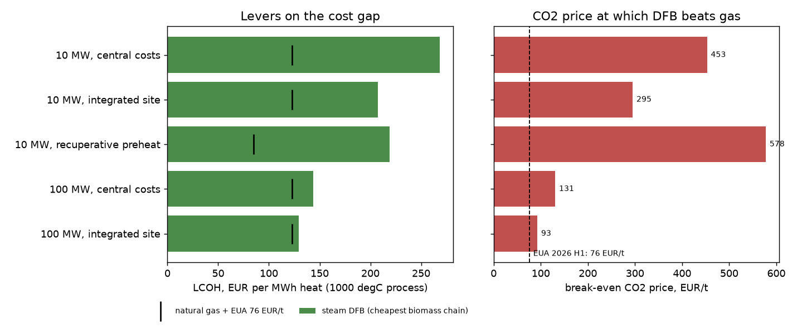

*Figure 0. The cheapest biomass chain (steam dual-fluidised-bed gasification, DFB) for a
1000 °C process against natural gas, and the CO2 price at which it breaks even. Source:
`data/levers_dfb_1000C.csv`.*

## Summary

1. **At 10 MW of heat no biomass chain beats natural gas at today's CO2 price.** The
   cheapest chain, steam DFB gasification, costs 268 EUR/MWh against 123 EUR/MWh for gas
   plus EU ETS allowances at 76 EUR/t. It would break even at a CO2 price of about
   **450 EUR/t**. None of the 10,000 Monte Carlo draws had any chain cheaper than gas.
2. **Scale and site integration matter most.** At 100 MW the same chain costs 144 EUR/MWh
   (break-even 131 EUR/t). On an integrated industrial site with shared staff and half the
   auxiliary/project cost it costs 129 EUR/MWh (**93 EUR/t**), close to today's CO2 price.
3. **Whether the burner may be changed matters more than any price input.** Only oxyfuel
   gasification with full methanation gives a gas that comes close to grid natural gas
   (Wobbe 50.6 vs 52.7 MJ/Nm3). If the furnace must run on its existing burner, that is the
   only feasible chain, and the cheapest LCOH is about **2.0–2.2 times** higher at every
   process temperature from 300 to 1300 °C.
4. **Electrolysis is expensive, and price-following helps only when it is oversized.**
   With a 1.5× oversized electrolyser and 24 h of H2/O2 storage, a perfect-foresight
   schedule cuts the electricity bill by about 23 %. A realisable rolling day-ahead schedule
   keeps 93 % of that saving. At 1.0× capacity the saving is below 1 %. Electrolytic H2 for
   methanation still roughly doubles the LCOH at 2025–26 German power prices.
5. **Temperature sweep finding.** With a burner retrofit and cold combustion air, the
   break-even CO2 price of the best chain *falls* as the process gets hotter, from 595 EUR/t
   at 300 °C to 379 EUR/t at 1300 °C. Hot processes waste more of each fuel's heat in the
   flue gas, so gas emits more fossil CO2 per MWh of useful heat and every euro of CO2 price
   counts for more. With recuperative air preheat the effect is much flatter (625 → 539 EUR/t).

## 1. Problem

Most industrial heat above about 500 °C still comes from burning natural gas. Direct
electrification is hard at very high temperatures and in existing furnaces. Gasified
biomass is a renewable gas fuel, but raw producer gas differs from natural gas. Air-blown
gas is diluted by nitrogen. Oxygen-blown gas needs an oxygen source. Methanation brings the
gas close to natural gas but needs hydrogen. A water electrolyser supplies both hydrogen and
oxygen and can follow the electricity price if it has storage.

The question: **for a given process (temperature, load profile, burner constraints), which
biomass chain gives the cheapest heat, and at what CO2 price does it beat natural gas?**

The reference case is a 10 MW process-heat duty at 1000 °C flue-gas exit, running
continuously (8000 full-load hours). Scenario P1–P4 vary the temperature and load profile.

## 2. Method chain

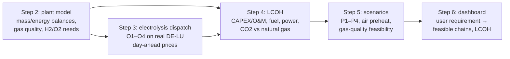

| Step | Repository | What it does | Tests |
|---|---|---|---|
| 2 | [biomass-heat-plant-model](https://github.com/DataWithSyed/biomass-heat-plant-model) | Agent-based plant (feed, gasifier air / oxyfuel / steam DFB, cleaning, methanation none / partial / full, electrolyser, H2/O2 storage, ASU, burner, demand, market). Quasi-equilibrium gasifier with elemental balances, water-gas shift and a calibrated CH4 yield; equilibrium methanation; burner available heat at the flue-gas exit temperature. | 33 |
| 3 | [biomass-heat-electrolysis-dispatch](https://github.com/DataWithSyed/biomass-heat-electrolysis-dispatch) | Electrolyser schedule on one year of hourly DE-LU day-ahead prices (Energy-Charts, CC BY 4.0; 2025-10-30 → 2026-10-30, mean 110.8 EUR/MWh): O1 follow demand, O2 price threshold, O3 perfect-foresight LP (HiGHS), O4 rolling 48 h look-ahead / 24 h commit LP with storage SOC carried between days. | 10 |
| 4 | [biomass-heat-lcoh](https://github.com/DataWithSyed/biomass-heat-lcoh) | Annuity LCOH (7 %, 20 y). Gasification-island CAPEX and O&M scaled from GoBiGas cost data (Thunman et al. 2019), electrolyser from Schmidt et al. (2017), storage and methanation from Götz et al. (2016), escalated to EUR 2025 with the euro-area HICP. Natural gas from Eurostat (DE, band I4, 2026-S1, excl. taxes) plus EUAs at the DEHSt H1 2026 auction average. Break-even CO2, tornado, 10k Monte Carlo, scale sweep, electrolyser sizing. | 19 |
| 5 | [biomass-heat-scenarios](https://github.com/DataWithSyed/biomass-heat-scenarios) | Process scenarios P1 300 °C, P2 800 °C two-shift, P3 1000 °C, P4 1300 °C retrofit-free; recuperative air preheat; ASU cost and power sourced (VTT Technology 91); DVGW G 260 H-gas Wobbe and density limits as a gas-quality screen; flame-temperature margin and available-heat rules; ranking. | 25 |
| 6 | [biomass-heat-dashboard](https://github.com/DataWithSyed/biomass-heat-dashboard) | Streamlit app: process requirement → feasible chains → LCOH breakdown and break-even CO2. Live recompute reproduces the step-5 matrix to 1e-9. New temperature sweep 300–1300 °C. | 20 |

The umbrella [docs/methods.md](../docs/methods.md) gives the literature behind each
modelling choice, and [docs/scenarios.md](../docs/scenarios.md) defines the scenarios.

## 3. Results

### 3.1 Plant model: what each chain needs per MWh of heat (10 MW, 1000 °C)

| Chain | Cold-gas eff. | Fuel LHV MJ/Nm3 | Wobbe MJ/Nm3 | Avail. heat | Biomass MWh/MWh | Electricity MWh/MWh | O2 kg/MWh | H2 kg/MWh |
|---|---|---|---|---|---|---|---|---|
| Air gasification | 0.745 | 5.53 | 6.43 | 0.385 | 3.49 | 0.019 | 0 | 0 |
| Oxyfuel, O2 from ASU | 0.800 | 9.72 | 12.5 | 0.493 | 2.54 | 0.055 | 184 | 0 |
| Steam DFB | 0.772 | 10.8 | 15.7 | 0.511 | 2.54 | 0.008 | 0 | 0 |
| Oxyfuel, electrolyser O2, H2 blended | 0.800 | 10.0 | 14.9 | 0.516 | 1.75 | 0.888 | 127 | 16.0 |
| Oxyfuel + partial methanation | 0.800 | 24.1 | 29.0 | 0.495 | 1.66 | 1.90 | 120 | 33.2 |
| Oxyfuel + full methanation | 0.800 | 33.5 | 50.6 | 0.522 | 1.08 | 2.42 | 78 | 43.2 |
| Natural gas (reference) | – | 36.8 | 52.7 | 0.523 | 1.91 (gas) | – | – | – |

Full methanation produces a near-natural-gas fuel and needs only 1.08 MWh of biomass per MWh
of heat (2.54 for oxyfuel without methanation), but it needs 2.4 MWh of electricity. Its electrolyser makes 4.4 times the oxygen
the gasifier needs. Air-blown gas loses so much heat with the nitrogen in the flue gas that
it needs 3.5 MWh of biomass per MWh of heat.

| 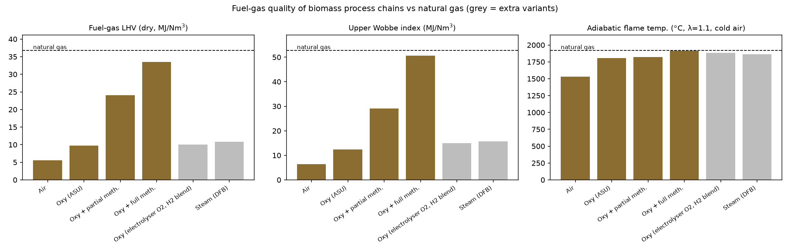 | 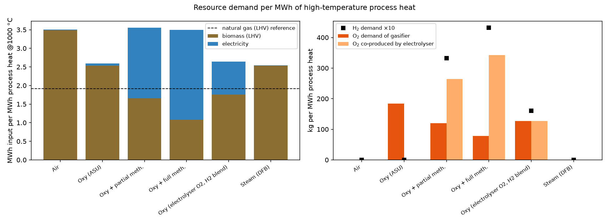 |
|---|---|
| *Fig. 2a. Fuel quality vs natural gas.* | *Fig. 2b. Inputs per MWh of heat.* |

### 3.2 Electrolysis dispatch on real day-ahead prices

Base case: electrolyser 1.5× the continuous rating, 24 h of H2 and O2 storage. Electricity
cost only, EUR per MWh of heat:

| Chain | O1 follow demand | O2 threshold | O3 perfect foresight | O4 rolling day-ahead | O3 purchase price EUR/MWh_el |
|---|---|---|---|---|---|
| Oxyfuel, electrolyser O2, H2 blended | 98.4 | 86.7 | 75.4 | 77.0 | 85.0 |
| Oxyfuel + partial methanation | 210.1 | 185.7 | 162.3 | 165.8 | 85.7 |
| Oxyfuel + full methanation | 268.1 | 236.4 | 206.1 | 210.5 | 85.3 |

* O3 saves 23 % against O1 in all three chains. O4, which only sees the next 48 hours,
  recovers 92.8 % of that saving.
* Oversizing is the lever, not storage alone (full methanation, O3, 24 h): 1.0× 266.3,
  1.25× 226.5, 1.5× 206.1, 2.0× 178.5 EUR/MWh_heat.
* Most of the storage value comes in the first 6–12 hours (1.5×, O3): 0 h 267.1, 6 h 215.7,
  12 h 210.5, 24 h 206.1, 48 h 202.9 EUR/MWh_heat.

| 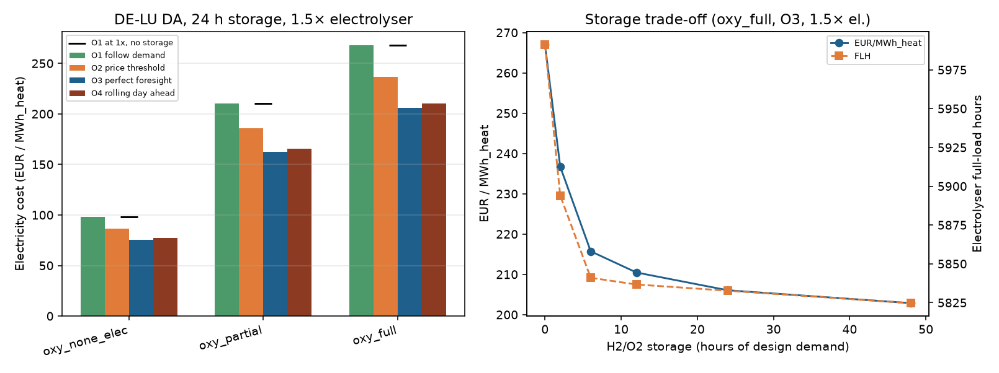 | 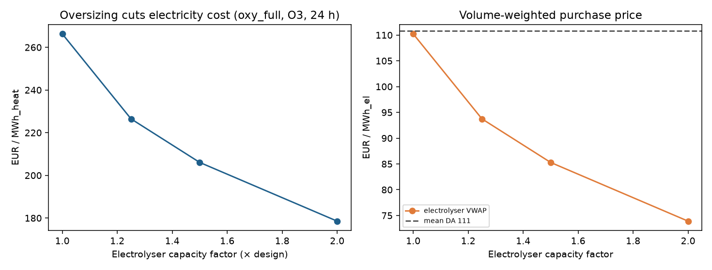 |
|---|---|
| *Fig. 3a. Electricity cost by strategy and storage.* | *Fig. 3b. Oversizing the electrolyser.* |

### 3.3 Levelised cost of heat (10 MW, 1000 °C)

Natural gas in the same furnace: 93.4 EUR/MWh fuel + 29.3 EUR/MWh CO2 = **122.7 EUR/MWh**.
Electrolyser chains are sized at their LCOH-optimal point on O4 dispatch (2.5×, 24 h; the
optimum is flat).

| Chain | CAPEX MEUR | LCOH | of which CAPEX / O&M / biomass / electricity | Break-even CO2 EUR/t | Integrated site LCOH (BE CO2) |
|---|---|---|---|---|---|
| Steam DFB | 114.8 | **268.2** | 135.4 / 55.2 / 76.8 / 0.8 | **453** | 207.4 (295) |
| Oxyfuel, O2 from ASU* | 120.3 | 282.3 | 142.0 / 57.4 / 76.8 / 6.1 | 489 | 221.4 (332) |
| Oxyfuel, electrolyser O2, H2 blended | 130.0 | 328.8 | 153.4 / 63.5 / 53.1 / 58.8 | 610 | 274.9 (470) |
| Air gasification | 135.2 | 329.8 | 159.5 / 62.5 / 105.6 / 2.2 | 612 | 261.5 (436) |
| Oxyfuel + partial methanation | 228.2 | 555.4 | 269.3 / 107.9 / 50.2 / 128.0 | 1,197 | 463.0 (958) |
| Oxyfuel + full methanation | 229.1 | 575.3 | 270.4 / 110.9 / 32.6 / 161.4 | 1,249 | 490.5 (1,029) |

\*Step-4 placeholder ASU cost. With the sourced ASU cost from step 5 (15.0 MEUR instead of
5.5 MEUR) this chain rises to 297.0 EUR/MWh.

* **Monte Carlo (10,000 draws, CO2 50–200 EUR/t):** P10–P90 of steam DFB 234–284 EUR/MWh,
  natural gas 104–160 EUR/MWh. Share of draws in which any chain is cheaper than gas: 0 %.
* **Tornado (steam DFB gap to gas):** the largest swings are the gas price (88 EUR/MWh),
  the CO2 price (58), the discount rate (53), auxiliary/project costs (47), the biomass
  price (43) and full-load hours (37). For full methanation the electrolyser cost (171),
  discount rate (107) and electricity price (97) dominate.
* **CAPEX for parity:** keeping all non-CAPEX costs fixed, the DFB plant could not match gas
  at 76 EUR/t even if it were free, because biomass and O&M alone exceed the cost of gas. At
  200 EUR/t it would need to cost 32 MEUR instead of 115 MEUR.
* **Scale (steam DFB, central / integrated):** 20 MW 213 / 174, 50 MW 166, 100 MW
  144 / 129 EUR/MWh; break-even CO2 at 100 MW 131 / 93 EUR/t.

| 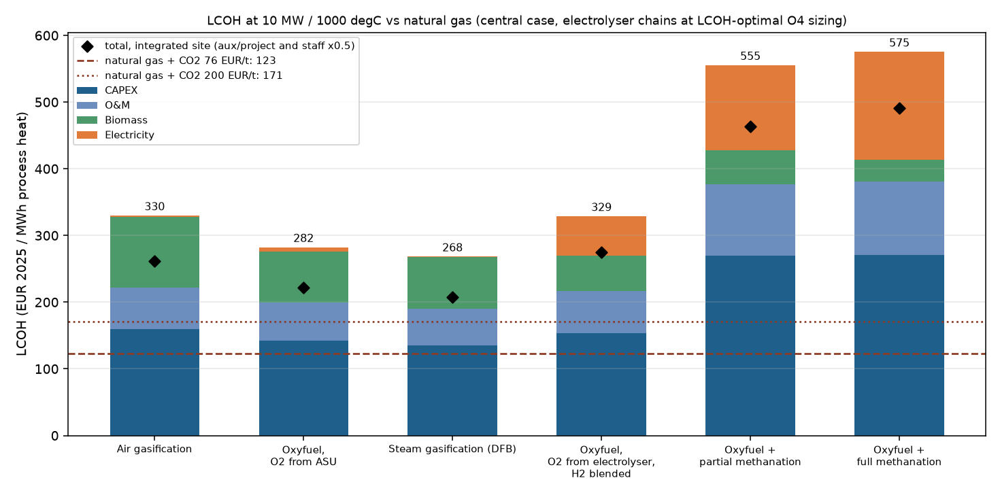 | 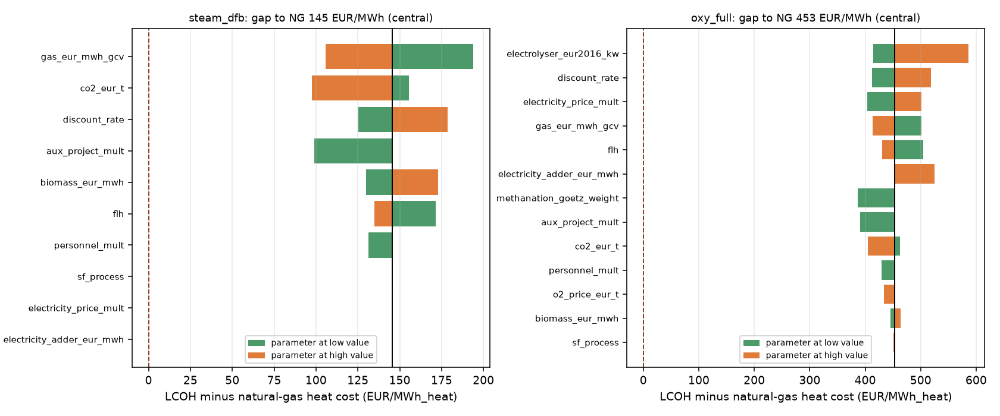 |
|---|---|
| *Fig. 4a. LCOH breakdown vs natural gas.* | *Fig. 4b. Tornado of the gap to gas.* |
| 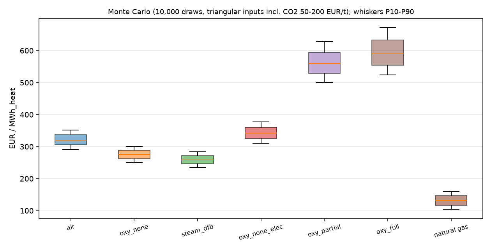 | 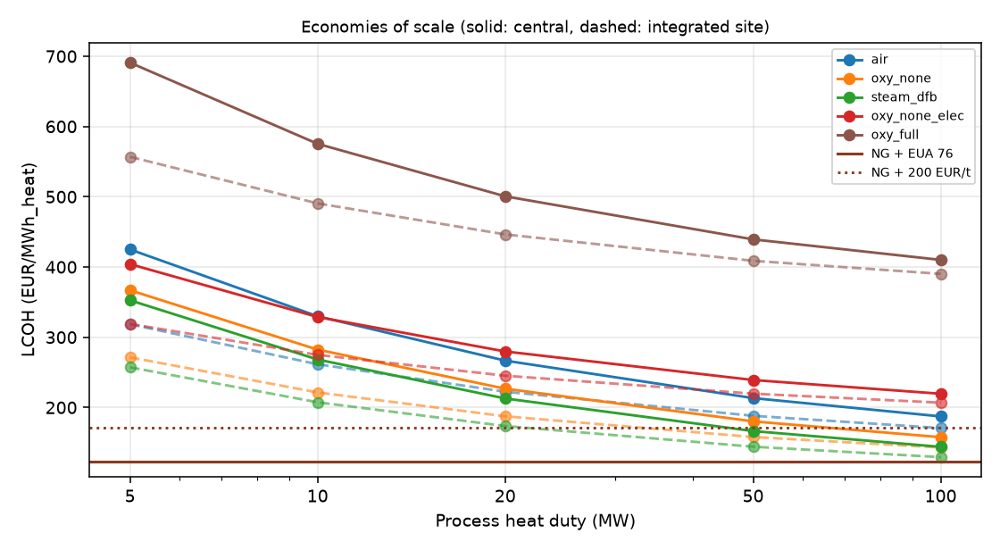 |
| *Fig. 4c. Monte Carlo LCOH.* | *Fig. 4d. Scale sweep.* |

### 3.4 Process scenarios and feasibility

The step-5 screen applies three rules to every chain: (i) gas quality against the DVGW G 260
H-gas limits (Wobbe 49.0–55.4 MJ/m3, relative density 0.55–0.75, H2 ≤ 10 vol-% as a
screening limit), which decides whether a burner retrofit is needed; (ii) an adiabatic
flame-temperature margin of at least 300 K above the process temperature; (iii) available
heat at least 0.30. Only full methanation passes (i), as "Wobbe-compatible": its Wobbe index
is inside the band, its relative density of 0.54 is just below it.

Best feasible chain, central costs, cold air / recuperative preheat:

| Scenario | Best chain | LCOH | Natural gas | Break-even CO2 EUR/t | Integrated site (cold air) |
|---|---|---|---|---|---|
| P1 300 °C, continuous | steam DFB | 193 / 186 | 73 / 68 | 595 / 625 | 142 (377) |
| P2 800 °C, two shifts (3,813 h) | steam DFB | 427 / 378 | 102 / 79 | 1,089 / 1,279 | 308 (718) |
| P3 1000 °C, continuous | steam DFB | 268 / 219 | 123 / 85 | 453 / 578 | 207 (295) |
| P4 1300 °C, retrofit-free | full methanation (only feasible) | 777 / 501 | 180 / 102 | 1,134 / 1,317 | 680 (962) |

* Utilisation matters more than temperature: running P2 continuously instead of two
  shifts would bring it from 427 to 237 EUR/MWh.
* Recuperative preheat lowers every chain's cost but helps natural gas more in relative
  terms, so the break-even CO2 price rises.
* At P4 with cold air, air gasification fails both the flame margin (230 K) and the
  available-heat rule (0.17).

| 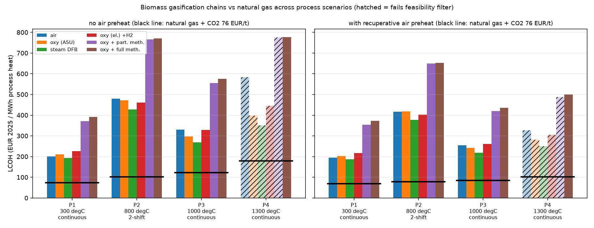 | 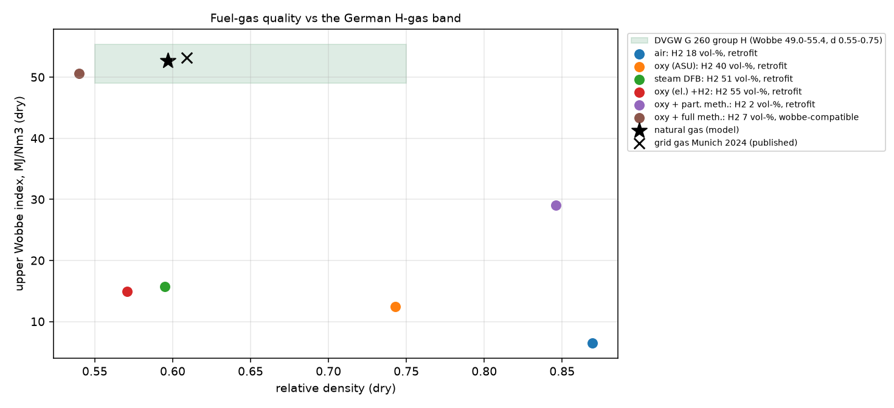 |
|---|---|
| *Fig. 5a. LCOH by process scenario.* | *Fig. 5b. Gas quality vs G 260 limits.* |

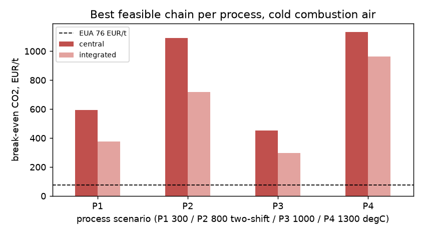

*Fig. 5c. Break-even CO2 of the best feasible chain per process, central vs integrated costs.*

### 3.5 Dashboard and the temperature sweep

The [dashboard](https://github.com/DataWithSyed/biomass-heat-dashboard) turns steps 2–5
into a screening tool. Its temperature sweep (continuous duty, central costs, 300–1300 °C in
100 K steps) gives the main cross-cutting result of the project:

| Process T | Retrofit allowed: best chain, LCOH / gas | Break-even CO2 (cold / recup.) | Retrofit-free: full methanation LCOH | Break-even CO2 (cold / recup.) |
|---:|---|---:|---:|---:|
| 300 °C | steam DFB, 193 / 73 | 595 / 625 | 391 | 1,457 / 1,491 |
| 600 °C | steam DFB, 215 / 88 | 539 / 605 | 446 | 1,376 / 1,452 |
| 800 °C | steam DFB, 237 / 102 | 498 / 592 | 499 | 1,316 / 1,423 |
| 1000 °C | steam DFB, 268 / 123 | 453 / 578 | 575 | 1,249 / 1,391 |
| 1200 °C | steam DFB, 316 / 155 | 405 / 558 | 692 | 1,174 / 1,350 |
| 1300 °C | steam DFB, 351 / 180 | 379 / 539 | 777 | 1,134 / 1,317 |

* **Retrofit or not is the first-order decision.** Without a burner retrofit only full
  methanation is feasible, at 2.0–2.2 times the LCOH of the best retrofit chain and a
  break-even CO2 price above 1,100 EUR/t at every temperature.
* **Hotter processes are relatively better cases for biomass** when a retrofit is possible:
  LCOH rises with temperature for every fuel, but the fossil CO2 avoided per MWh of useful
  heat rises faster (0.23 → 0.56 t/MWh from P1 to P4 with cold air, while the DFB cost gap
  grows only from 120 to 171 EUR/MWh), so the break-even CO2 price falls by about a third from 300 to 1300 °C
  with cold air. Air preheat flattens this (−14 %), because it recovers much of the flue-gas
  loss that makes hot processes expensive for gas.
* Steam DFB is the cheapest feasible chain at every temperature once a retrofit is allowed.
  Air gasification drops out at 1200 °C and above with cold air.

| 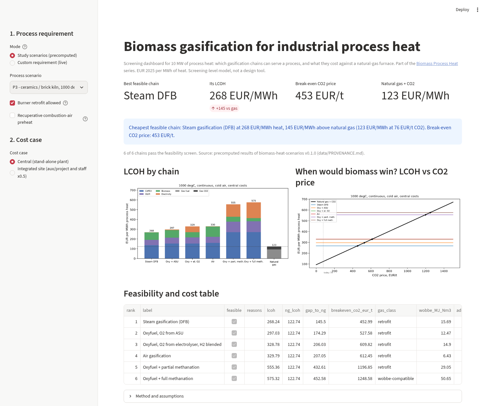 | 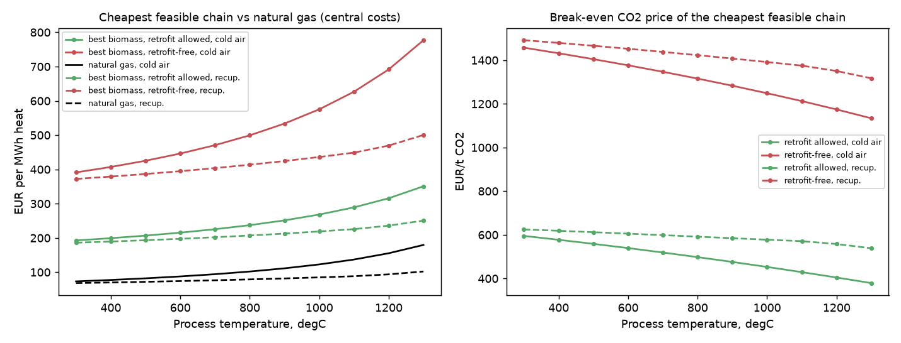 |
|---|---|
| *Fig. 6a. Dashboard (headless screenshot).* | *Fig. 6b. Temperature sweep.* |

## 4. Discussion

At 10 MW and 2025–26 prices, biomass gasification does not compete with natural gas for
process heat unless the CO2 price reaches several hundred EUR/t. The gap comes mainly from
capital cost (about half of the DFB LCOH) and from biomass plus O&M, not from electricity.
That changes with three levers that the project quantified: plant scale (10 → 100 MW cuts
DFB from 268 to 144 EUR/MWh), shared infrastructure on an integrated site (another
15–60 EUR/MWh) and high utilisation (two-shift operation more than doubles the gap).
Together they bring the break-even CO2 price down to about 90–130 EUR/t, against an EUA
price of 76 EUR/t in H1 2026.

The electrolysis-based chains are attractive technically because they give a gas close to
natural gas that existing burners can use, and their oxygen co-product can replace an air
separation unit. Economically they are the most expensive chains. Flexible operation on the
day-ahead market helps, but only with an oversized electrolyser, and even an ideal schedule
buys power at around 85 EUR/MWh, which keeps electricity the largest cost item after CAPEX.

## 5. Limitations

* **Cost basis.** Gasification CAPEX is scaled from a first-of-a-kind bio-SNG plant
  (GoBiGas) and is conservative for a simple fuel-gas gasifier. HICP escalation probably
  understates 2025 plant costs. Electrolyser costs are pre-2020 expert estimates.
* **Plant model.** Steady state per hour; quasi-equilibrium gasifier with a calibrated CH4
  yield and no tar, C2+, sulphur or nitrogen species; single-stage equilibrium methanation
  without a carbon-deposition check; burner without flame dissociation, so flame
  temperatures above about 2000 °C with preheated air are overstated; NOx not assessed.
* **Heat integration.** Recovered syngas heat is reported but not optimised. In the DFB
  chain it does not cover the steam demand (2.7 vs 3.1 MW), so flue-gas heat recovery would
  be needed and is not modelled or costed.
* **Prices.** One year of DE-LU day-ahead prices; no correlation between gas, power and CO2
  prices in the Monte Carlo; no taxes, grid fees (except as a sensitivity) or subsidies. A
  single 19 MW_th gas furnace sits below the EU ETS 1 threshold, so the national CO2 price
  or ETS 2 would apply in practice; the 50–200 EUR/t range covers this.
* **Dispatch.** Ideal storage without compression energy; O3 is an upper bound; O4 has a
  48 h look-ahead with a free terminal storage level per window.
* **Feasibility rules.** Gas-quality limits are for public-grid gas, not burner approvals.
  The ASU cost is extrapolated far below its reference size. Two-shift operation assumes hot
  standby without start-up losses.
* **Validation.** The thermodynamics were cross-checked against Cantera during development,
  the ASU cost scaling reproduces the VTT reference value (47.7 vs 47.6 MEUR), and the repos
  are checked against each other (the scenarios LP reproduces the dispatch O4 result; the
  dashboard reproduces the scenario matrix to 1e-9). Nothing is validated against measured
  data from a running furnace.

## 6. Reproducing the results

Each step repo has a `scripts/` entry point and a pinned data cache; see its README.
The dashboard installs the earlier packages from their git URLs. To redraw the synthesis
figures here:

```bash
pip install pandas matplotlib
python report/scripts/make_figures.py
```

## References

Literature (DOIs checked against api.crossref.org):

* Buttler, A., Spliethoff, H. (2018). Current status of water electrolysis for energy storage, grid balancing and sector coupling via power-to-gas and power-to-liquids: A review. *Renewable and Sustainable Energy Reviews* 82, 2440–2454. https://doi.org/10.1016/j.rser.2017.09.003
* Channiwala, S.A., Parikh, P.P. (2002). A unified correlation for estimating HHV of solid, liquid and gaseous fuels. *Fuel* 81(8), 1051–1063. https://doi.org/10.1016/S0016-2361(01)00131-4
* Götz, M., Lefebvre, J., Mörs, F., et al. (2016). Renewable Power-to-Gas: A technological and economic review. *Renewable Energy* 85, 1371–1390. https://doi.org/10.1016/j.renene.2015.07.066
* Janusz-Szymańska, K., Dryjańska, A. (2015). Possibilities for improving the thermodynamic and economic characteristics of an oxy-type power plant with a cryogenic air separation unit. *Energy* 85, 45–61. https://doi.org/10.1016/j.energy.2015.03.049
* Kopyscinski, J., Schildhauer, T.J., Biollaz, S.M.A. (2010). Production of synthetic natural gas (SNG) from coal and dry biomass – A technology review from 1950 to 2009. *Fuel* 89(8), 1763–1783. https://doi.org/10.1016/j.fuel.2010.01.027
* Macal, C.M., North, M.J. (2010). Tutorial on agent-based modelling and simulation. *Journal of Simulation* 4(3), 151–162. https://doi.org/10.1057/jos.2010.3
* Madeddu, S., Ueckerdt, F., Pehl, M., et al. (2020). The CO2 reduction potential for the European industry via direct electrification of heat supply (power-to-heat). *Environmental Research Letters* 15(12), 124004. https://doi.org/10.1088/1748-9326/abbd02
* Molino, A., Chianese, S., Musmarra, D. (2016). Biomass gasification technology: The state of the art overview. *Journal of Energy Chemistry* 25(1), 10–25. https://doi.org/10.1016/j.jechem.2015.11.005
* Naegler, T., Simon, S., Klein, M., Gils, H.C. (2015). Quantification of the European industrial heat demand by branch and temperature level. *International Journal of Energy Research* 39(15), 2019–2030. https://doi.org/10.1002/er.3436
* Puig-Arnavat, M., Bruno, J.C., Coronas, A. (2010). Review and analysis of biomass gasification models. *Renewable and Sustainable Energy Reviews* 14(9), 2841–2851. https://doi.org/10.1016/j.rser.2010.07.030
* Rönsch, S., Schneider, J., Matthischke, S., et al. (2016). Review on methanation – From fundamentals to current projects. *Fuel* 166, 276–296. https://doi.org/10.1016/j.fuel.2015.10.111
* Schmidt, O., Gambhir, A., Staffell, I., et al. (2017). Future cost and performance of water electrolysis: An expert elicitation study. *International Journal of Hydrogen Energy* 42(52), 30470–30492. https://doi.org/10.1016/j.ijhydene.2017.10.045
* Short, W., Packey, D.J., Holt, T. (1995). *A Manual for the Economic Evaluation of Energy Efficiency and Renewable Energy Technologies*. NREL/TP-462-5173. https://doi.org/10.2172/35391
* Thunman, H., Gustavsson, C., Larsson, A., et al. (2019). Economic assessment of advanced biofuel production via gasification using cost data from the GoBiGas plant. *Energy Science & Engineering* 7(1), 217–229. https://doi.org/10.1002/ese3.271
* Woolcock, P.J., Brown, R.C. (2013). A review of cleaning technologies for biomass-derived syngas. *Biomass and Bioenergy* 52, 54–84. https://doi.org/10.1016/j.biombioe.2013.02.036
* Zainal, Z.A., Ali, R., Lean, C.H., Seetharamu, K.N. (2001). Prediction of performance of a downdraft gasifier using equilibrium modeling for different biomass materials. *Energy Conversion and Management* 42(12), 1499–1515. https://doi.org/10.1016/S0196-8904(00)00078-9

Reports, standards and data:

* Hannula, I., Kurkela, E. (2013). *Liquid transportation fuels via large-scale fluidised-bed gasification of lignocellulosic biomass.* VTT Technology 91. ISBN 978-951-38-7979-2. https://publications.vtt.fi/pdf/technology/2013/T91.pdf
* DVGW G 260 (2021), gas quality, 2nd gas family group H (Table 2 limits as reproduced by SWM Infrastruktur, *Erdgasbeschaffenheit: Jahresmittel für 2024*). Details in the scenarios repo `docs/sources.md`.
* Energy-Charts.info (Fraunhofer ISE), DE-LU day-ahead prices, CC BY 4.0; underlying source Bundesnetzagentur | SMARD.de.
* Eurostat `nrg_pc_203` (non-household gas prices, DE, band I4, excluding taxes) and `prc_hicp_aind` (euro-area HICP).
* DEHSt, German EUA auction reports (H1 2026 average 76.02 EUR/t).
* C.A.R.M.E.N. e.V., wood-chip price index 2025 (WG35).

Full source notes per input: [LCOH cost basis](https://github.com/DataWithSyed/biomass-heat-lcoh/blob/main/docs/cost_basis.md),
[scenario sources](https://github.com/DataWithSyed/biomass-heat-scenarios/blob/main/docs/sources.md),
[plant-model assumptions](https://github.com/DataWithSyed/biomass-heat-plant-model/blob/main/docs/assumptions.md).
