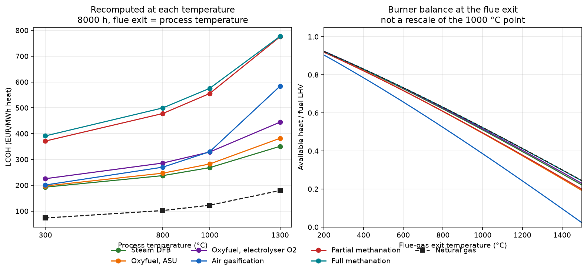

# Scenario screening

Industrial process-heat scenarios for the biomass gasification chains: process
temperature, flue-gas exit temperature, load, fuel quality, and a cost rank
against natural gas.

This is step 5 of [Biomass Process Heat](https://github.com/DataWithSyed/biomass-process-heat).
The roadmap name is `biomass-heat-scenarios`. The code lives **in this umbrella
repository, under `scenarios/`**. There is no separate repository.

It installs and calls:

* [`biomass-heat-plant-model`](https://github.com/DataWithSyed/biomass-heat-plant-model) for mass and energy balances, adiabatic flame temperature, Wobbe index and available heat
* [`biomass-heat-lcoh`](https://github.com/DataWithSyed/biomass-heat-lcoh) (`bhlcoh`) for the central cost build-up and the natural-gas reference

## How to run

```bash
cd scenarios
python -m venv .venv && source .venv/bin/activate
pip install -e ".[dev]"
pytest -q                          # 27 tests
python scripts/run_screening.py    # results/ and figures/
```

`pip install` also pulls `biomass-heat-electrolysis-dispatch`, because the LCOH
package depends on it. This step does not re-solve that dispatch LP.

## What is screened

Four process temperatures from the umbrella scenario sheet: **300, 800, 1000,
1300 °C**. Heat duty 10 MW. In the ranked rows the flue gas leaves at the
process temperature (no recuperation). Those are different quantities:

* **Flue-gas exit temperature** sets the available heat. The burner balance is evaluated again at each exit temperature.
* **Process temperature** is compared with the adiabatic flame temperature. A chain is thermally infeasible when the flame is not hotter than the process, even if the flue could leave cooler.

Loads:

| Case | Hours | Role |
|---|---:|---|
| Continuous, temperature comparison | 8000 h/y | Same full-load hours as the LCOH model (Thunman). Named **P3** at 1000 °C and **P4** at 1300 °C. |
| P1 | 8760 h/y at 300 °C | The no-outage calendar year written in the scenario sheet. |
| Two-shift | 4160 h/y = 16 h × 5 d × 52 wk | Synthetic, no holidays. Named **P2** at 800 °C. Also run at the other temperatures so load is not mixed up with temperature. |

Fuel screen: upper Wobbe index and relative density against **EASEE-gas CBP
2005-001/02** (13.60–15.81 kWh/m³ at 25 °C combustion and 0 °C volume;
relative density 0.555–0.700). The plant-model Wobbe uses those reference
temperatures on an ideal-gas basis, not a real-gas ISO 6976 value. Hydrogen
cuts of 1 vol-% and 10 vol-% are screening assumptions, because the CBP gives
no hydrogen number. Passing the band is not a burner certificate and not a
regulatory check. Details: [docs/assumptions.md](docs/assumptions.md).

## Results

Costs are **model estimates** on the LCOH central basis (EUR 2025). They are
not measured heat prices. At 1000 °C and 8000 h the screen reproduces the
published LCOH totals exactly (difference 0.000 EUR/MWh).

No chain beats natural gas in any case. The cheapest biomass chain at every
temperature and both load shapes is steam gasification (DFB), on a full rank
basis (no electrolyser dispatch).

### Temperature, 10 MW, 8000 h, flue exit = process temperature

| Process / flue °C | DFB | Natural gas | Gap | DFB break-even CO2 | Air gasification (rank) |
|---:|---:|---:|---:|---:|---|
| 300 | 193 | 73 | 120 | 595 EUR/t | 201 (3rd) |
| 800 | 237 | 102 | 135 | 498 EUR/t | 270 (3rd) |
| 1000 | 268 | 123 | 146 | 453 EUR/t | 330 (4th) |
| 1300 | 351 | 180 | 171 | 379 EUR/t | 584 (4th) |

EUR/MWh of heat, rounded. Full precision: [results/screening_results.csv](results/screening_results.csv).



What changes with temperature, from a fresh plant-model balance rather than a
rescale of the 1000 °C table:

* Available heat is not one curve. At a 1300 °C flue exit, air gasification
  still delivers only **17 %** of its LHV (adiabatic flame temperature about
  1530 °C, margin about **230 K**). DFB still delivers **34 %**, natural gas
  **36 %**. Air drops from 3rd to 4th between 800 and 1000 °C, behind the
  oxyfuel chain that blends electrolyser hydrogen, and at 1300 °C its LCOH
  is 584 against 445 for that blend.
* Scaling the published 1000 °C LCOH by the biomass-intensity ratio does not
  reproduce this. For air at 1300 °C that shortcut gives **747** EUR/MWh.
  The recomputed figure is **584**. CAPEX meets a scale exponent below 1, so
  a larger duty does not raise capital cost in proportion, and the natural-gas
  reference moves as well.
* The euro gap from DFB to gas **widens** from 120 to 171 EUR/MWh between
  300 and 1300 °C. The break-even CO2 price **falls** from 595 to 379 EUR/t,
  because the gas furnace's direct fossil CO2 per MWh of useful heat rises
  (0.230 to 0.565 t/MWh). A lower break-even is not a smaller bill.

### Load

At 800 °C, cutting the year from 8000 h to the two-shift 4160 h raises the
DFB LCOH from 237 to **391** EUR/MWh (natural gas stays 102, because the gas
reference is fuel and CO2 only). That utilisation penalty is larger than
moving the same continuous case from 800 to 1000 °C (237 to 268). P1 at
300 °C and 8760 h is 180 EUR/MWh for DFB against 73 for gas.

### Fuel gas

No biomass chain passes the interchangeability screen. Full methanation is
the near miss: Wobbe **50.6** MJ/Nm³ sits inside the cited band (natural gas
in this model is 52.7), but relative density **0.540** is below the 0.555
floor, and the fuel still contains **6.5 vol-%** hydrogen. The other chains
are well outside the band (air Wobbe 6.4 MJ/Nm³). They remain in the cost
rank as thermally feasible fuels that would need a purpose-designed burner.
This screen does not design or certify that burner, and it adds no retrofit
CAPEX.

### Emissions, kept separate

| | 300 °C | 1000 °C | 1300 °C |
|---|---:|---:|---:|
| Natural gas, direct fossil stack CO2 (t/MWh heat) | 0.230 | 0.386 | 0.565 |
| DFB, biogenic stack CO2 (t/MWh heat) | 0.366 | 0.627 | 0.945 |
| Air, biogenic stack CO2 | 0.544 | 1.194 | 2.705 |

Biomass-chain direct fossil CO2 is 0 in this screen because the carbon in the
fuel gas is biogenic. **Lifecycle greenhouse-gas emissions are not estimated.**
Biogenic stack CO2, displaced fossil CO2 and a lifecycle result are different
numbers. Grid-electricity emissions and biomass supply-chain emissions are omitted.

## Cross-repo limits

These bounds are why some rows are marked provisional and why off-reference
break-even prices are not taken from `bhlcoh.breakeven_co2_price`.

1. **`bhlcoh.chain_inputs` has no flue-exit approach.** Ranked rows use approach 0, so the helper's temperature argument is the flue exit and, in this screen, also the process temperature. A cooler flue without air preheat is rejected. Recuperation is still a plant-model enhancement, not a result of this step.
2. **`bhlcoh.breakeven_co2_price` and `breakeven_gas_price` call `ng_design()` at 1000 °C.** They are not used. Break-even is recomputed from `ng_design` at the case flue temperature. At 1000 °C the two agree.
3. **The O4 day-ahead LP is not re-solved.** `bhlcoh.dispatch.run_dispatch` is fixed at 1000 °C, and the price file is not in the installed package. For a continuous flat duty, electricity EUR per MWh is the published 2.5× / 24 h result scaled by the plant-model throughput ratio (capacity and storage hours stay in proportion to the design point). The LCOH study describes that sizing optimum as flat to about 1.5 %. The air-versus-blend gap at 800 °C is about 16 EUR/MWh, so that uncertainty does not by itself explain the reorder; the 1300 °C gap is about 140 EUR/MWh. It is still a scaled estimate, not a new dispatch run.
4. **Two-shift electrolyser rows are provisional.** The hourly shape changes, and the continuous-duty electricity price is reused. DFB, oxyfuel with an ASU, and air gasification do not use that price. Their two-shift ranks are full results. A one-week plant-model simulation of the synthetic two-shift profile matches the design-point biomass integral for DFB.
5. **Same cost basis as the LCOH step**, including the unsourced ASU CAPEX and the shared GoBiGas gasification-island cost. No burner retrofit, no grid fees, no measured heat price.

## Layout

```
src/bhscenarios/     screening package
scripts/run_screening.py
tests/test_screening.py
docs/assumptions.md
results/             CSV, ranking markdown
figures/             LCOH and available-heat figure
```

## Licence

MIT, same as the umbrella repository.
